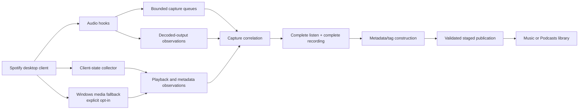

# Floggfy implementation wiki

This wiki is a high-level map of how Floggfy records audio already being played by
the Windows Spotify desktop client, proves which playback it belongs to, enriches
it, and publishes it without silently replacing unrelated files.

The major rule is simple: compressed bytes are the recording; decoded-output and
playback observations are evidence about ownership. Floggfy does not write decoded
PCM to disk and does not independently fetch audio.

## Read next

- [Capture and correlation](capture-and-correlation.md) — hook points, codec paths,
  listen coverage, decoder ownership, and capture speed.
- [Metadata and publication](metadata-and-publication.md) — enrichment, tag merge,
  library layout, duplicate handling, repair, and atomic publication.
- [Operations and safety](operations-and-safety.md) — settings, optional
  capabilities, bounded work, failures, logs, and maintenance expectations.
- [FLAC overlap and repair incident](flac-overlap-and-repair-incident.md) — a
  concrete duplicate-decoder incident, the evidence it produced, and safe ideas
  for classifying or repairing overlapping compressed captures.

For exact policy constraints, see the maintained
[capture and publication invariants](../capture-invariants.md). User-facing setup
and settings remain in the project [README](../../README.md).

## Component map

The first-party source has four directories. [Telemetry](../../native/telemetry) owns the privacy settings map, request rules, counters and dumps. [Media](../../native/media) owns capture, matching, recording and metadata. [UI](../../native/ui) owns the To Disk menu, Saved playlists, audio labels and file shortcuts. [Tooling](../../native/tooling) holds shared Windows, settings, filesystem, SQLite and LevelDB access, hashing and hook support. The DLL and launcher entry points are at the root of `native/`.

| Responsibility | Primary implementation |
| --- | --- |
| Long paths, directory creation and search handles | [Windows paths](../../native/tooling/windows_path.h), [Windows handles](../../native/tooling/windows_handle.h) |
| SQLite connections, prepared statements and parameter binding | [SQLite tooling](../../native/tooling/sqlite.h) |
| Read-only LevelDB table and log traversal | [LevelDB reader](../../native/tooling/leveldb_reader.h) |
| Hook discovery and structural validation | [`spotify_hook_discovery.cpp`](../../native/tooling/spotify_hook_discovery.cpp) |
| Audio hooks, queues, association, and publication scheduling | [`audio_history.cpp`](../../native/media/audio_history.cpp) |
| Decoder/playback ownership stages | [`decoder_ownership.cpp`](../../native/media/decoder_ownership.cpp) |
| Spotify client timeline and enrichment collector | [`metadata_collector.js`](../../native/media/metadata_collector.js) |
| Collector injection and native message bridge | [`metadata_bridge.cpp`](../../native/media/metadata_bridge.cpp) |
| Optional Windows media-session fallback | [`media_session.cpp`](../../native/media/media_session.cpp) |
| Recording inspection and destination resolution | [`recording_file.cpp`](../../native/media/recording_file.cpp), [`existing_quality.cpp`](../../native/media/existing_quality.cpp) |
| Metadata merge and codec-specific tagging | [`metadata_update_core.cpp`](../../native/media/metadata_update_core.cpp) |
| Staged, no-overwrite file publication | [`file_publication.cpp`](../../native/media/file_publication.cpp) |
| Folder and filename layout | [`library_layout.cpp`](../../native/media/library_layout.cpp) |

