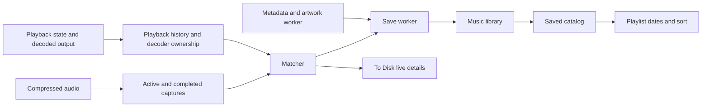

# Implementation walkthrough and optimization review

Spotify supplies two timelines. Compressed input may be ahead of the song the
user hears, and the renderer may report the song after bytes have already
arrived. The capture worker owns both timelines and associates them when the
evidence agrees. The save worker owns disk writes. The renderer and To Disk menu
read snapshots so a slow save or cache lookup can finish in the background.

## Startup and compatibility

The loader exposes the Windows version APIs Spotify expects. It forwards those
calls to the system DLL and starts a worker that reads the INI and waits for the
Spotify and Chromium components it needs. The worker activates each supported
feature and keeps the app responsive when an optional component is unavailable.
The separate launcher loads the same Floggfy library for that install mode.
The startup monitor groups activation work where it can and keeps checking for
late-loaded components. The kill switch applies to supported networking in
participating Spotify processes. Block Updates manages the local Update
directory's access rules.

Startup and [operations](operations-and-safety.md) are described in
[version_proxy.cpp](../../native/version_proxy.cpp) and
[startup_launcher.cpp](../../native/tooling/startup_launcher.cpp).

## Media input and format validation

Audio callbacks submit bounded observations. The capture worker owns codec
buffers and organizes the compressed bytes by decoder lifetime. It follows Ogg
pages, FLAC frames, MPEG frames, and AAC packets using format-specific sequence,
structure, and sample-count checks. Decoded output can show that the decoder
played audio and provide timing and quality evidence. The recording keeps the
original encoded audio. AAC packets are wrapped in M4A for publication.

The worker keeps growing streams in blocks, shares a memory budget with
validation and publication, and rejects captures that have lost required
bytes. The validator reads Ogg and AAC input from these blocks, copying an Ogg
page when it crosses a block boundary and needs contiguous storage. FLAC tracks
frames and their sample ranges, while MP3 can use a declared frame count when
present.

The readers share slot insertion, memory admission, and the transfer from active
buffers to the ready queue. Each codec still decides when it has enough evidence
to make that transfer. A failed stream can retain its unresolved bytes or be
discarded with its ownership evidence and audit intact.

A pause can leave a stream open. A seek, a buffer loss, or a fresh decoder
lifetime changes the evidence the worker has to validate. Those events cannot
substitute for validation of a complete stream. [Capture and correlation](capture-and-correlation.md),
[audio_history.cpp](../../native/media/audio_history.cpp).

## Playback and matching

The renderer collector reports URI, playback instance, duration, position, and
states such as buffering, paused, or local playback. The native bridge validates
each message before passing it to the worker. The optional Windows media-session
fallback can supply playback observations when the preferred client state is
unavailable.

The matcher tracks compressed captures and playback history independently. It
prefers an exact identity supported by decoder ownership. When that evidence
is unavailable, it checks compatible timing and duration and requires a unique
candidate. It retains completed recordings long enough for delayed playback
evidence to arrive. A complete recording that ages out after the configured
number of media starts can be saved under `Unmatched`. An incomplete stream
fails that archive gate. The active and completed capture lists use the same
archive decision. Active entries also release decoder-specific state when they
retire. [client_playback.h](../../native/media/client_playback.h),
[decoder_ownership.cpp](../../native/media/decoder_ownership.cpp),
[capture invariants](../capture-invariants.md).

After a skip, the next song can enter playback while the previous decoder is
still draining and a third stream is preloaded. Each has its own evidence. The
UI can show quality from an identified active stream while the save decision
still waits for completeness. The fallback matcher applies
`TimeOffsetToleranceMs` to timing and `DurationToleranceMs` to duration.
Competing candidates can make a timing match ambiguous even when one is closer.

This pass replaced temporary maps of timeline and transition fields with slots
that refer to the original payload. The parsers still reject duplicate keys,
invalid URIs, malformed clocks, and inconsistent flags. On 10,000 parses of a
representative timeline fixture, heap allocations went from 330,000 to 210,000.
For 10,000 parses of a buffering-transition fixture they went from 160,000 to
30,000. These are parser measurements. Live playback timing was outside the
measurement.

The matcher still calibrates against new playback metadata when audio has yet
to arrive. With no retained audio, it skips candidate searches. An unchanged
expected identity skips the exclusive bridge lock when diagnostics are off.
A Windows fixture with five metadata records and no audio counted 100,000
shared and 10,000 exclusive lock acquisitions over 10,000 passes before the
change and zero after it. Both revisions calibrated a subsequent identity.

Bound audio quality now belongs to the metadata record it describes. It can
remain visible after the save worker takes the audio buffer, then retires with
the playback occurrence. The matcher shares one traversal for active decoder
buffers and completed sources. The weak match check stops on the first native
identity result because any such evidence is enough to withhold a timing-only
assignment. The exact matcher still reads all matching observations. Two
recorded Ogg replays queued the exact source bytes in both builds with identical
logs. A third replay did not queue a validated save in either build.

## Metadata, artwork, and lyrics

The metadata record stays alive while a capture or save job uses it. The bridge
picks up available Spotify fields and artwork references first. A worker checks
which fields are missing and which fallbacks are enabled. It can recover tags
through the bounded LevelDB reader, try artwork already supplied through the
client and its cache, and request remaining fields or images online. Enrichment
results merge into the owning record after the worker checks their identity.
Cached WebP artwork can be converted to PNG before embedding.

Tracks and episodes share recording identity checks while supplying different
metadata fields, including album details for tracks and show, date, and artwork
when available for episodes. [Metadata and publication](metadata-and-publication.md),
[metadata_bridge.cpp](../../native/media/metadata_bridge.cpp).

## Save worker and library

The save worker takes completed jobs, validates the encoded data, builds tags,
and uses the same recording identity to resolve ordinary, numbered, alternate,
and duplicate paths. It can skip an existing complete match, update missing
metadata, or upgrade an owned file when quality and format rules allow. It writes
and flushes a staging file before claiming the destination. If the destination
is locked or changes, the worker can retry or replan without losing the completed
capture. A same-format upgrade validates one locked snapshot and uses it for the
metadata merge. Memory accounting includes the retained source and scratch
allocations for validation, tagging, and publication. [file_publication.cpp](../../native/media/file_publication.cpp),
[library_layout.cpp](../../native/media/library_layout.cpp).

Each directory lookup checks the ordinary name and legacy aliases to find an
established recording. A vacancy is usable only after the existing candidates
have been checked. Duplicate names prefer compact Spotify IDs and expand them
when required. Missing IDs use the existing `[no-id-…]` name. The path alone
cannot authorize an overwrite.

PR #34 now builds the duplicate directory, track prefix, and sanitized title
once per lookup. Path sanitization uses a fixed character list without creating
a string for every character. In a Windows allocation probe, 1,000 ordinary
paths went from 116,000 allocations to 13,000 and 1,000 four-name duplicate
lookups went from 714,000 to 36,000. The old and new builds produced the same
108,800 paths in both the Windows and portable comparisons.

The resolver and filename conversion also share one ordered candidate list.
Each entry records whether the current naming style allows a new file there.
The generator builds the identity hashes once and checks generated suffixes
only against the ordinary aliases. A Windows comparison of 7,776 inputs
preserved every candidate, its order, and its write eligibility. In 5,000
lookups of a numbered track with old artist and disc aliases, allocations fell
from 7,665,000 to 2,325,000. This measurement covers candidate generation.

## To Disk and Saved

To Disk reads a playback and quality snapshot. A separate worker checks whether
the song has a valid saved file. Menu callbacks use that result for the Song
shortcut and recheck the path when opening Explorer. The menu also writes the
same preferences used by the workers.

The Saved column queries a SQLite index under Save Location. The catalog verifies
file evidence and reads recording tags when the on-disk stamp has changed. The
renderer caches returned dates, displays them on mounted rows, and uses the full
playlist order when playing from a Saved sort. Repeated tracks keep their
playlist occurrence so selecting a row starts playback from the corresponding
position. **Marked DB Rebuild** scans the
library and can backfill missing save dates from file creation time when the
metadata settings allow it. The release builds SQLite for size and leaves out
JSON functions and shared-cache mode. The app's schema uses ordinary indexed
tables and one worker-owned connection. [to_disk_menu.cpp](../../native/ui/to_disk_menu.cpp),
[marked_catalog.cpp](../../native/ui/marked_catalog.cpp),
[marked_playlist_sort.js](../../native/ui/marked_playlist_sort.js).

One indexed query pages through the entire batch of requested tracks in URI and
path order. The worker resets the statement before checking each page's files and
returns verified dates in the original request order. Stamp checks reuse one
path string while checking every parent and file. A Windows fixture requesting
256 tracks, half saved, returned the same 6,400 dates across 50 requests.
Median elapsed time across five runs fell from 587 to 341 ms and C++ heap
allocations fell from 307,653 to 122,503. The comparison made 38,400 filesystem
probes in each build.

## Telemetry and user diagnostics

The optional telemetry module classifies known reporting destinations and honors
each enabled category. Native and renderer observations contribute to the block
counts. Opt-in dumps use a bounded queue and format payloads off the callback
path. Queued-telemetry cleanup handles known pending files at startup and normal
exit. Coverage depends on the request paths the running client exposes.

Ordinary logs report outcomes and warnings. The matcher log explains how
candidates were evaluated. Stream dumps preserve raw chunks and metadata for
replay, and telemetry dumps preserve blocked request details. These are features
of the shipped DLL with runtime controls. [Telemetry controls](../telemetry-testing.md),
[async_log.cpp](../../native/tooling/async_log.cpp),
[stream_dump.h](../../native/media/stream_dump.h).

## Shared tooling and release build

The tooling directory holds the bounded queues and retry schedule, INI parsing
and persistence, Windows file operations, database access, and binary and text
readers. Keeping those operations shared lets the media, UI, and telemetry
modules use the same mechanics while choosing their own input limits and
recovery policy. The release build embeds the defaults and renderer scripts.
Fixtures, fault injection, fuzzers, and replay runners live under `tests/`.
[Component map](README.md#component-map),
[release and development builds](../../AUDIO-HISTORY.md#release-build).

## Where to look for more savings

| Area | Evidence to collect and work to remove |
|---|---|
| Capture and matcher | With audio retained, the worker still rechecks matching, retirement, and quality after a 50 ms wait or a queued event. Count scans on pauses, skips, and a long episode. If unchanged ticks dominate, gate matching on evidence changes while retaining capture retirement and save-queue retries. Compare match, archive, and retry results in capture replays. |
| Save worker | Measure the incoming-file copy during a large quality upgrade. Determine how much scratch memory remains after the locked destination parse is reused, and how much the codec tag writer actually needs. |
| Saved column | The batched Windows fixture spent most of its time checking files. Measure renderer work separately on a large playlist. Evaluate further storage changes against rebuilds, duplicate paths and stale-file detection. |
| Enrichment | Count disk-cache reads, artwork attempts, and online requests per recording with warm and cold caches. Track and album already share a scan when both IDs are known. Target repeated attempts for the same pinned metadata and artwork before widening cache scope. |
| Startup and tooling | Settings already read one startup snapshot. Measure module readiness and activation separately. Share work only when the same startup attempt asks for the same capability, and preserve fallback when an older client supplies fewer capabilities. |
| Telemetry and diagnostics | URL classification uses fixed rules. Compare blocking alone with payload logging enabled to see whether copying, decompression, or formatting dominates. Keep test fixtures in their own targets and check optional diagnostics separately for DLL size. |
